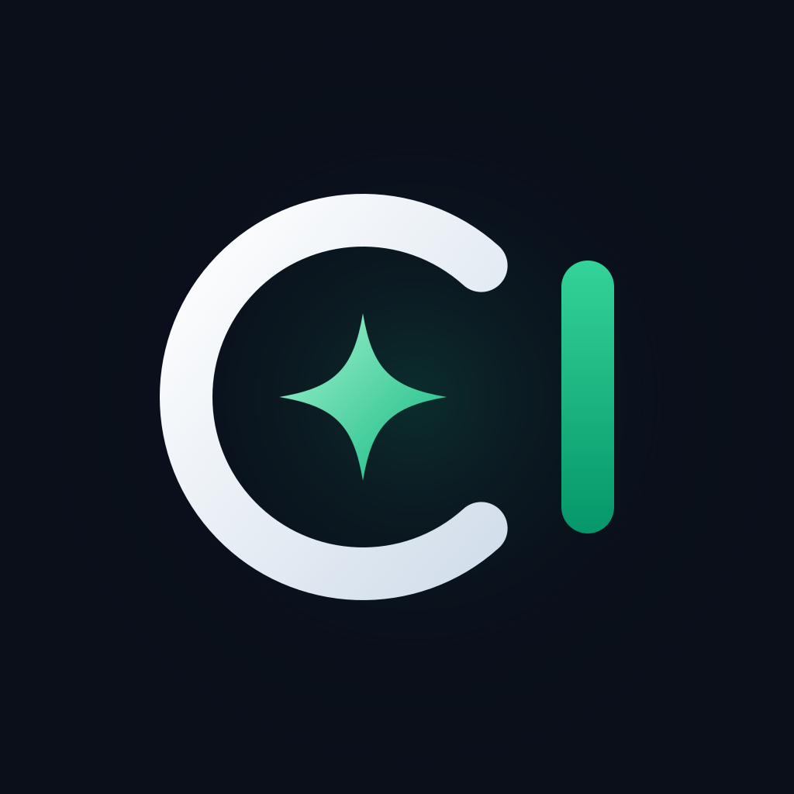

# Privacy-First AI Data Control Center

**Real-time local privacy guardrails, secret redaction & cloud governance for AI coding assistants**

---

### 🎯 What We Build

AI coding agents (**Claude Code**, **Cursor**, **Antigravity**, **Gemini CLI**) accelerate software engineering—but without local guardrails, a single tool call can read environment secrets, private SSH keys, or NDA-protected customer data.

**Privacy-First AI Data Control Center** solves this with a two-layer open-core architecture:
- **💻 On-Device Guard (`local-agent`):** Evaluates `PreToolUse` hooks in **< 5ms**, blocks unauthorized file/command execution before it happens, redacts sensitive tokens locally, and buffers events in an offline `node:sqlite` queue. **Raw file contents never leave the laptop.**
- **☁️ Team Governance Plane (`backend` + `frontend`):** Centralized **NestJS + PostgreSQL** control center (140 REST endpoints, 29 entities) featuring 4-role RBAC (`OWNER`, `ADMIN`, `MEMBER`, `VIEWER`), policy versioning & dry-run simulation, risk scoring, security alerts, audit trails, and `@Cron` compliance reports.

---

### 🔗 Quick Links

- 📦 **Core Monorepo:** [Privacy-First-AI-Data-Control-Center](https://github.com/Privacy-First-AI-Data-Control-Center/Privacy-First-AI-Data-Control-Center)
- 🌐 **Live Swagger UI:** [dynamic-enchantment-production-a30c714b.up.railway.app/api](https://dynamic-enchantment-production-a30c714b.up.railway.app/api)
- 🔌 **Live API (`v1`):** [dynamic-enchantment-production-a30c714b.up.railway.app/api/v1](https://dynamic-enchantment-production-a30c714b.up.railway.app/api/v1)

---

### 👥 Team Glitch in the Matrix (AIUB — CSC4161)

| Member | GitHub | Focus Areas |
| :--- | :--- | :--- |
| **Shohag Rana** | [@shohagranasuvo](https://github.com/shohagranasuvo) | Local Hook Agent, Connectors & Integrations (`QueryRunner` tx), Telemetry, Agent Sync, `@Cron` Reports, DevOps |
| **Ayan Halder** | [@ayanhalder27](https://github.com/ayanhalder27) | JWT Authentication, Users, Workspaces, RBAC Members & Enrolled Devices |
| **Ahnaf Tanvir** | [@ahnaftanvir21](https://github.com/ahnaftanvir21) | Policy Engine & Versions, Dry-Run Simulator, Sensitive Data Findings & Risk Enforcement |
| **Md. Rofiqullah Munna** | [@munna89-ig](https://github.com/munna89-ig) | Executive Dashboard, Security Alerts, Immutable Audit Logs, Data Retention & Exports |

*Supervised by **Md. Khairul Alam Mazumder ([@Robinak47](https://github.com/Robinak47))**, Department of Computer Science, American International University-Bangladesh (AIUB).*
